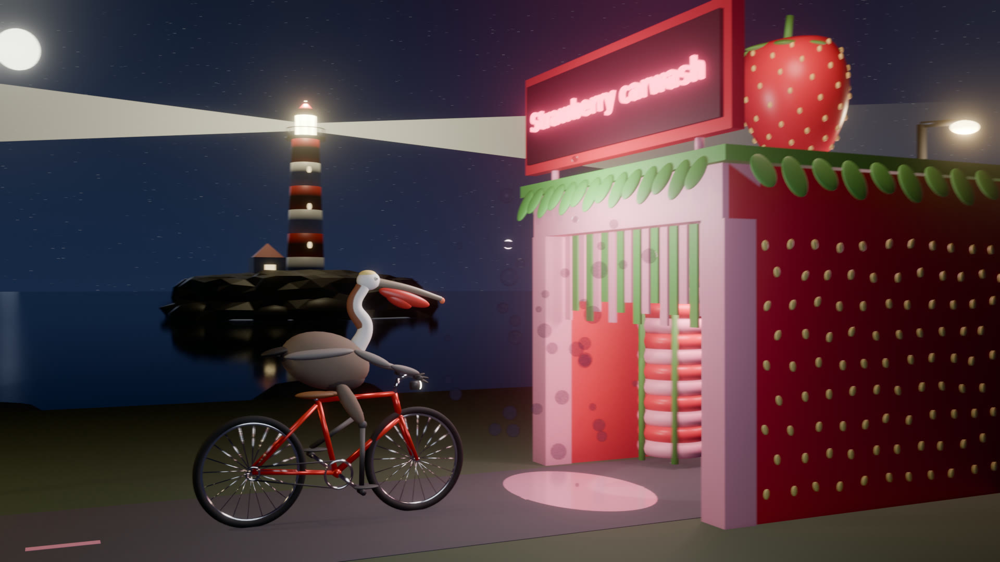

# Strawberry Carwash Pelican

A pelican rides a bicycle up to the **Strawberry carwash** at night, while a lighthouse sweeps its beam out at sea.

**Watch it:** https://maxcurzi.github.io/pelican-strawberry-carwash/

[](https://maxcurzi.github.io/pelican-strawberry-carwash/)

It combines two informal AI benchmarks, Simon Willison's
[pelican riding a bicycle](https://simonwillison.net/tags/pelican-riding-a-bicycle/) and OpenRouter's
[lighthouse at night](https://openrouter.ai/benchmarks/media/sketch/lighthouse-at-night), and adds a strawberry-themed car wash.
Everything in the scene is built from Python in Blender, with no downloaded models, textures or images.

## Benchmark prompt

> Make an animated 3D scene of a pelican riding a bicycle up to a car wash with a sign that says "Strawberry carwash". It is night, and a lighthouse on a rock sweeps its beam in the background. Build everything yourself: no downloaded models, textures or images.

What to look for when comparing results:

- The pelican is recognisable: long bill, throat pouch, and its feet on the pedals.
- The bicycle has two wheels, a frame that joins up, and a chain drive.
- The sign text is spelled exactly and can be read.
- The night scene stacks in the right order: sky, sea, rock, tower, lantern.
- It moves: wheels and pedals turn, and the beam sweeps.

## Rebuild it

Needs Blender 5.0 and `ffmpeg`.

| File | What it builds |
|---|---|
| `blender/build_common.py` | Shared helpers (rods, ellipsoids, tubes, two-bone leg solver) |
| `blender/build_bicycle.py` | Frame, spoked wheels, drivetrain, bars, saddle |
| `blender/build_pelican.py` | California brown pelican in breeding plumage |
| `blender/build_carwash.py` | Strawberry carwash, neon sign, brushes, giant strawberry |
| `blender/build_scene.py` | Night stage: sea, stars, moon, streetlamps, camera, bloom |
| `blender/build_lighthouse.py` | Rock island, striped tower, lantern, rotating beam |
| `blender/build_animate.py` | Rig and per-frame keys: pedalling, braking, camera move |
| `blender/build_scene_day.py` | The earlier daytime stage (not used by default) |

To rebuild the scene, open `blender/pelican_bicycle.blend` and run this in Blender's Python console:

```python
exec(open(bpy.path.abspath("//build.py")).read())
```

To render the 288 frames and encode the MP4 (headless, Vulkan GPU backend):

```sh
blender/render_animation.sh
```
